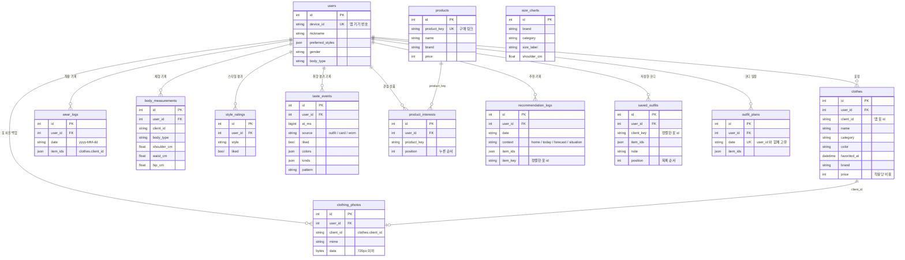

# DB·히스토리 통합

기존 사진 분류·날씨·상품 API는 `main.py`에 유지하고, DB 기능만 `db_api.py`에 연결했습니다.
앱의 옷장·착용 기록은 SharedPreferences가 기준입니다. 동기화는 해당 폰의 서버 목록을
추가·수정·삭제하는 단방향 스냅샷입니다. 옷장 옷 사진은 줄인 사진 한 장을 `clothing_photos`에 따로 백업하고,
**백업 코드**(= 기기 번호)로 다른 폰 · 다시 설치한 앱에 기록을 되살릴 수 있습니다 (마이페이지 > 데이터 백업 · 복원).

## 실행

1. `python -m pip install -r requirements.txt`
2. `.env.example`을 `.env`로 복사하고 Supabase의 PostgreSQL 연결 문자열을 `DATABASE_URL`에 설정합니다.
3. 빈 개발 DB는 `DB_AUTO_CREATE=true`로 테이블을 생성합니다. 실제 측정처럼 보이는 샘플은 생성하지 않습니다.
4. 기존 팀원 DB는 `python apply_migrations.py` 한 번으로 `migrations/001` ~ `004`를 차례로 적용합니다
   (표 · 칸을 더하기만 하고 데이터는 지우지 않음, 여러 번 실행해도 안전).
   SQL Editor를 쓰고 싶으면 `001_body_record_client_id.sql`, `002_user_data_tables.sql`,
   `003_backup_and_recommendation_logs.sql`, `004_outfit_book_and_prices.sql`을 차례로 붙여넣고 Run 해도 같습니다.
   서버를 켤 때 빠진 표 · 칸이 있으면 서버 창에 `[DB] 빠진 표 · 칸: …`이 나옵니다.
   `create_all`은 기존 테이블의 누락 컬럼을 추가하지 않습니다. 이전 스키마가 더 오래됐다면 추가 비교가 필요합니다.
   `GET /api/health/database` 응답에 `missing`이 보이면 `hint`에 적힌 마이그레이션이 아직 적용되지 않은 것입니다.
5. 쇼핑 상품 카탈로그를 DB에 넣습니다: `python seed_catalog.py` (앱 ShopCatalog와 같은 9개, 다시 실행해도 중복 없음).
   넣지 않아도 `/api/products`는 `data.SHOP_CATALOG`로 같은 상품을 보여 줍니다.
6. `python -m uvicorn main:app --host 0.0.0.0 --port 8000`

DB 미설정·연결 실패 시에도 서버는 시작합니다. DB API는 503으로 실패하며 기존 이미지 API는 유지됩니다.
`GET /api/health/database`의 `ready`는 연결·측정 테이블 접근 가능 여부이며 저장 완료 증명이 아닙니다.
실제 Supabase 연결은 이 저장소의 자동 테스트에서 수행하지 않습니다.

## 앱 연결 및 저장

- `BackendApi.BASE_URL`: 에뮬레이터는 `http://10.0.2.2:8000`, 실제 폰은 개발 PC의 LAN 주소.
- `FashionApp`이 화면 요청 전에 기기 UUID를 준비합니다. DB 요청은 `X-Device-Id`가 필수입니다.
- 기기 UUID는 로그인/권한 인증이 아닙니다. 공개 서비스 배포 전 실제 사용자 인증·소유권 검증이 필요합니다.
- 옷장·착용 기록·선호 스타일·성별·관심 상품·취향 평가 기록은 로컬 저장 후 DB 전송 대기열에 등록됩니다
  (항목마다 최신 상태 하나만 남아, 서버가 켜지면 최신 상태로 맞춰집니다).
- 동의한 체형 기록은 사진을 제외하고 숫자만 대기열에 보관합니다. 앱 실행 중 30초마다,
  데이터 변경 시, 상태 배지 재확인 시 재시도합니다. 앱 재실행에도 대기열은 남습니다.
- 체형 기록의 `clientId` 고유 제약으로 응답 유실 후 재전송을 중복 저장하지 않습니다.
- 저장 끄기는 미전송 체형 기록을 버립니다. 이미 서버에 보낸 기록은 별도의 삭제 메뉴로 삭제합니다.
- 히스토리는 서버 기록을 조회합니다. 오프라인이면 오류/재시도 안내를 표시하고 로컬 분석은 계속 가능합니다.
- **백업 · 복원**: 마이페이지 > 데이터 백업 · 복원에서 백업 코드를 복사해 두면, 새 폰(또는 다시 설치한 앱)에서
  코드를 넣어 옷장(사진 포함) · 착용 기록 · 선호 스타일 · 성별 · 관심 상품 · 취향 기록 · 스타일 점수를 가져옵니다.
  가져오면 그 폰이 같은 기기 번호를 이어서 쓰고, 이 폰의 기존 기록은 바뀝니다. 두 폰의 기록을 합치지는 않습니다.
  체형 동의 · 알림 설정은 새 폰에서 다시 정합니다. 코드를 아는 사람은 기록을 볼 수 있으므로 공유하지 않습니다.
- **서버 백업 끄기**: 같은 화면에서 끄면 `DELETE /api/me`로 서버의 내 기록을 모두 지우고 이후로 보내지 않습니다
  (끈 동안은 기기 번호를 붙이지 않아 서버에 사용자가 새로 생기지 않음). 다시 켜면 폰 기록을 전부 다시 올립니다.
- 옷 사진 백업은 앱 폴더의 옷 사진(file://)만, 긴 변 720px · 2MB 이하로 줄여 올립니다. 샘플 · 인터넷 사진은 올리지 않습니다.
  팀원 PC마다 서버가 따로 돌기 때문에 서버 폴더가 아니라 공용 DB(`clothing_photos.data`)에 저장합니다.

`size_charts`의 단면/둘레 구분 ORM과 조회 API를 통합했습니다. 사이즈 추천·자동 CSV 수집은 연결하지 않았습니다.

## 무엇이 DB에 저장되나 (앱 저장소 → DB 표)

| 앱에서 하는 일 | 앱 저장소 (폰이 기준) | DB 표 | API |
|---|---|---|---|
| 옷 등록 · 수정 · 삭제 · 하트 · [계속 보관] | `WardrobeStore` | `clothes` | `POST /api/wardrobe/sync` |
| 오늘 입은 옷 · 달력 | `WearLogStore` | `wear_logs` | `POST /api/wear-logs/sync` |
| 온보딩 선호 스타일 | `ProfileStore` | `users.preferred_styles` | `POST /api/profile/styles` |
| 마이페이지 성별 | `UserPreferencesViewModel` | `users.gender` | `POST /api/profile/gender` |
| 쇼핑 · 상품 상세 · 옷장 '관심 옷' 하트 | `ProductInterestStore` | `product_interests` | `POST /api/product-interests/sync` |
| 코디 👍👎 · 취향 카드 · 착용(색 · 종류 · 조합) | `TastePreferenceStore` | `taste_events` | `POST /api/taste-events/sync` |
| 스타일 취향 점수 | `StylePreferenceStore` | `style_ratings` | `POST /api/style-preference/rate` |
| 체형 분석 결과 (동의 시, 숫자만) | `DbSync` 대기열 | `body_measurements` | `POST /api/body-measurements` |
| 옷장 옷 사진 (줄인 사진 한 장) | `WardrobeStore` 사진 파일 | `clothing_photos` | `POST /api/wardrobe/photos` |
| 화면에 보여 준 추천 코디 | `RecommendationLog` | `recommendation_logs` | `POST /api/recommendations/sync` |
| 코디 카드 🔖 저장 · 메모 | `SavedOutfitStore` | `saved_outfits` | `POST /api/saved-outfits/sync` |
| 코디 카드 📅 날짜 정하기 | `OutfitPlanStore` | `outfit_plans` | `POST /api/outfit-plans/sync` |
| 옷 수정 화면 브랜드 · 가격 | `WardrobeStore` | `clothes.brand`, `clothes.price` | `POST /api/wardrobe/sync` |
| 쇼핑 상품 목록 | `ShopCatalog` (앱 안) | `products` (`seed_catalog.py`) | `GET /api/products` |
| 브랜드 사이즈표 | — | `size_charts` | `GET /api/size-charts` |

DB에 넣지 않는 것: 체형 사진(전신 사진), 옷 사진의 원본 · 배경 제거 등 다른 버전(보여 주는 사진 한 장만 백업),
체형 촬영 동의 상태(기기마다 따로 동의),
네이버 검색 결과 · 가상 피팅 결과 이미지(외부 서비스 응답), 무신사 랭킹 데모 옷장(앱 안 고정 데이터).

조회용 API
- `GET /api/product-interests` — 내 관심 상품 (카탈로그 상품이면 이름 · 가격 · 사진 포함)
- `GET /api/product-interests/popular` — 여러 사용자가 많이 담은 상품 순위 (개수만, 기기 번호 불필요)
- `GET /api/taste-events/summary` — DB 기록으로 다시 계산한 색 · 종류 · 조합 · 스타일 점수 (👍 +2 / 👎 −1 / 착용 +1)
- `GET /api/profile` — 옷 · 착용 · 하트 · 관심 상품 개수, 최근 체형, 선호 스타일, 성별
- `GET /api/wardrobe/photos/{옷 id}` · `GET /api/taste-events` — 백업 코드로 복원할 때 사진 · 취향 기록 받기
- `GET /api/recommendations/stats` — 내 추천 성과 (보여 준 코디 중 👍 · 그대로 입음 · 일부 입음 비율, 화면별)
- `GET /api/recommendations/stats/all` — 모든 사용자를 합친 추천 성과 (AI 성능 측정표용, 개수 · 비율만)
- `DELETE /api/me` — 서버에 저장된 내 기록 전부 삭제 (개인정보 삭제 요청)
- `GET /api/saved-outfits` · `GET /api/outfit-plans` — 저장한 코디 · 코디 일정 (복원할 때도 사용)
- `GET /api/stats/overview` — 모든 사용자를 합친 DB 현황 (옷 · 착용 · 저장 코디 · 일정 개수, 옷 종류 · 색 · 선호 스타일 순위,
  가격을 넣은 옷 평균 가격, 지난 일정대로 입은 날 수) — 발표 · 보고서용, 개인 정보 없이 숫자만

추천 성과 계산 규칙 (앱 마이페이지 'AI 추천 성과'와 같음)
- 같은 날 같은 화면(홈 · 오늘 · 5일 예보 · 상황별)의 같은 옷 조합은 한 번만 센다. 날씨를 받기 전 임시 코디, 관심 옷이 섞인 코디는 세지 않는다.
- 👍 / 👎: 같은 옷 조합에 마지막으로 누른 코디 평가 (`taste_events`, source = outfit)
- 그대로 입음: 추천한 날부터 2일 안의 착용 기록(`wear_logs`)에 코디 옷이 모두 있음 / 일부 입음: 절반 이상 있음

`product_likes`(숫자 상품 id)는 예전 스키마로 남겨 두었고, 앱은 고정 상품 id(구매 링크)를 쓰는
`product_interests`를 사용합니다.

## 표 관계 (ERD)

## 검증

`python -m unittest discover -s tests -v`

테스트는 독립 SQLite DB에서 실제 ORM·FastAPI 요청을 실행합니다. Supabase 자격증명이나
운영 DB에 접근하지 않습니다. 이미지 모델 가중치를 내려받아 실제 추론하는 검증은 별도로 필요합니다.
