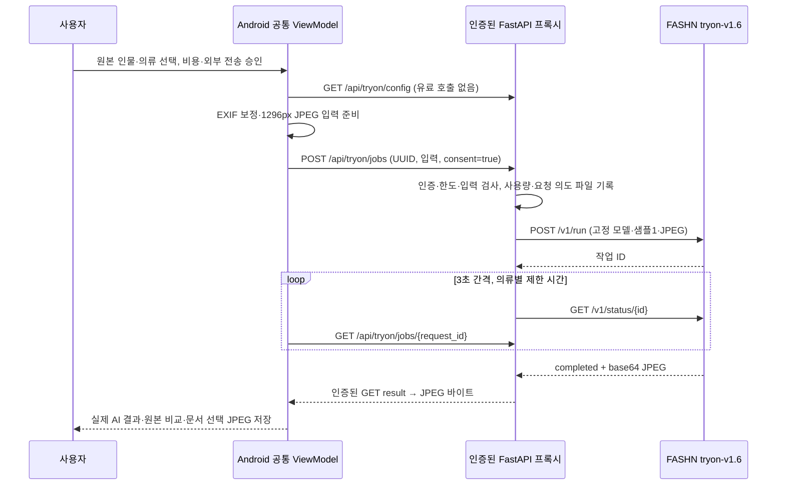

# 마법봉 AI 가상피팅 구현 보고서

작성일: 2026-10-19. 원본 TEAM_FINAL_REVIEW.zip과 보존용 추출본은 수정하지 않았습니다. 수정은 별도 `work/ai-fitting/modified`에서만 수행했습니다. Git commit/push/merge, 운영 서버 배포, 실제 FASHN 유료 호출은 하지 않았습니다.

## 1. 수정 전 실제 동작

원본 VirtualFittingScreen의 AutoFixHigh 마법봉은 이미 선택한 인물 URI와 의류 목록을 AiTryOnScreen으로 전달했습니다. 관절 정렬은 별도의 CenterFocusStrong 아이콘이 worn/refit을 호출했습니다. 따라서 원본 마법봉이 관절 정렬만 실행했다고 보고하지 않습니다.

기존 AI 화면에는 외부 전송 동의, 순차 생성, 원본 비교, JPEG 문서 저장 기능이 있었습니다. 다만 FASHN 키가 BuildConfig에 포함되고 앱이 직접 유료 API를 호출했으며, 생성 상태와 코루틴이 화면에 묶여 있었습니다. Musinsa TryOnView에도 생성·동의·저장 구현이 중복되어 있었습니다.

## 2. 수정 후 동작

마법봉은 새 작업일 때 인물 사진 → 선택 의류 → 지원 카테고리·조합을 확인하고 누락 이유를 안내합니다. 입력이 준비되면 기존 수동 화면과 이어지는 AI 화면을 엽니다. 진행 중인 작업이 있으면 신규 생성 대신 기존 작업을 엽니다.

HTTPS AI 서버와 개인 접속 토큰이 없으면 생성 버튼을 비활성화합니다. 연결 설정만으로 생성하지 않습니다. 매 생성·재생성마다 원본 사진의 외부 전송, 최대 유료 요청 횟수, 다중 의류의 중간 결과 전송, 과금·결과의 한계를 안내하고 ‘확인하고 AI 생성’을 눌러야 시작합니다. 거절은 요청 0회입니다.

로딩 메시지, 상태 조회, 실제 서버 결과 미리보기, 원본 비교, JPEG 저장, 다시 만들기, 수동 피팅 복귀를 제공합니다. 오류·시간초과가 발생해도 이전 성공 결과와 수동 배치 상태를 지우지 않습니다. 불확실한 전송은 신규 POST 대신 기존 ID의 GET만 재개합니다. 미설정 상태에 수동 합성을 AI 결과로 표시하는 경로는 없습니다.

## 3. 변경 파일과 함수

| 파일 | 주요 변경 |
|---|---|
| VirtualFittingScreen.kt | 마법봉 입력 검사·공유 모델 전달, 명시적인 ‘자동 정렬’ 버튼, ManualFittingViewModel로 수동 상태·비동기 사진 준비 유지 |
| AiTryOnScreen.kt | 공통 화면, sharedTryOnViewModel, 명시적 승인, HTTPS 서버·개인 토큰 설정, 원본 비교·JPEG 저장·상태 복구·대기 중단 |
| TryOnViewModel.kt (추가) | generate/resume/watch/cancel, Activity 범위 단일 작업, 동기 중복 클릭 차단, SavedStateHandle 요청 ID, 메모리 입력 스냅샷 |
| TryOnRepository.kt | 기존 EXIF·리사이즈·JPEG 저장 처리 재사용, 인증된 프록시 submit/status/result/cancel/check, HTTPS·바이트 제한·리다이렉트 차단 |
| MusinsaClosetScreen.kt | TryOnView가 같은 AiTryOnScreen을 재사용, 기존 상품·구매 목록 유지 |
| app/build.gradle.kts | FASHN_API_KEY BuildConfig 필드 제거 |
| backend/tryon_proxy.py (추가) | Settings, FashnProvider.run/status, TryOnService.submit/generate/authenticate/commit, 인증·한도·내구성 중복 방지·취소·결과 API |
| backend/main.py | AI 라우터 등록과 서버 종료 정리만 추가 |
| backend/tryon_tokens.py (추가) | 서버 운영자의 사용자별 무작위 개인 토큰 발급 도구 |
| AiTryOnFlowTest.kt (추가) | Mock gateway를 쓰는 생성·동의·복구·저장 UI 테스트 |
| PresentationFittingUiTest.kt | 입력 누락 및 기존 수동 조절·자동 정렬 회귀 검증 추가 |
| backend/tests/test_tryon_proxy.py (추가) | 네트워크 차단 Fake provider로 유료 요청·보안·복구 계약 검증 |
| .github/workflows/android-debug-apk.yml | pytest 설치·실행으로 새 Backend Mock 테스트도 CI에 포함 |
| README.md, 수정사항.md, docs의 AI 안내 | 위험한 과거 클라이언트 키 설정을 현재 서버 설정으로 대체/과거 기록임을 표시 |
| backend/AI_TRYON_SETUP.md (추가) | 서버 키·토큰·한도·HTTPS·단일 worker·보관·Mock 재현 문서 |

TryOnPlan의 카테고리·지원 의류 검증을 재사용했습니다. 기존 TryOnBatch 유틸리티와 테스트는 보존하며, 운영 생성 실행은 서버 한 곳으로 모았습니다. 기존 저장 코드는 인증된 결과 JPEG 바이트를 시스템 문서 선택기로 쓰도록 조정했습니다.

## 4. FASHN 호출 흐름

상의+하의는 최대2회, 상의→하의 순서로 생성하며 중간 결과를 다음 인물 입력으로 사용합니다. 원피스는 단독입니다. 수동 합성 캔버스·드래그·확대·회전 좌표는 보내지 않습니다. 의류는 원본 URI를 우선 사용하고 원본 정보가 없으면 기존 의류 이미지(누끼 포함)를 사용합니다. 투명 누끼는 JPEG 변환 시 흰 배경으로 처리합니다. 서버에서도 이미지·EXIF·픽셀·바이트를 검증합니다.

공식 문서와 대조하여 tryon-v1.6, /v1/run, /v1/status/{id}, category, mode, num_samples, output_format 구조를 유지했습니다. return_base64=true를 추가하여 공개 결과 CDN URL 대신 인증된 서버 결과를 제공합니다. URL을 결과로 위조하거나 임의 서버 URL을 따라가지 않습니다.

참고: https://docs.fashn.ai/api-reference/tryon-v1-6 및 https://docs.fashn.ai/api-overview/api-fundamentals (2026-10-19 확인). 문서 대조와 Mock 계약 검증이며 실제 유료 호환성·생성 품질 검증을 의미하지 않습니다.

## 5. 수동 기능과 보호 대상

관절 기반 fit/refit 계산, 옷 선택·원본 인물 선택, pan/zoom/rotation 제스처, 크기 증감·슬라이더, 투명도·의류 레이어 로직을 유지했습니다. fit 함수는 원본과 텍스트가 일치합니다. 자동 정렬은 별도 버튼이며 확대 배율을1로 초기화하는 기존 동작을 유지합니다. 수동 상태는 ViewModel 메모리에서 구성 변경을 견딥니다.

체형분석 V2, 측정·실루엣 계산, 옷장 스크롤 컴포넌트, 추천 엔진, 개인정보 동의·최소수집 정책 구현 파일은 원본과 동일합니다. 기존 체크리스트의 FASHN 설정 항목만 서버 설정으로 갱신했습니다. 원본 추출본의 276개 파일을 업로드 ZIP과 대조한 결과 불일치0개입니다.

## 6. Mock 검증 범위

| 필수 항목 | 검증 방법 |
|---|---|
| 인물 사진 없이 마법봉 | 실제 Compose 버튼 → 인물 선택 안내, 생성 화면 미진입 |
| 옷 없이 마법봉 | 인물 선택 후 버튼 → 의류 선택 안내 |
| 동의 거절 | Compose 확인 창 취소 → 업로드·POST 0회, 서버 consent=false 거절 |
| 정상 생성 | Mock 입력 원본 URI 확인 → 서버 정상 상태 → 결과 표시 |
| 중복 클릭 | ViewModel 동기 차단 + 같은 UUID 동시 제출, 유료 provider 호출1회 |
| 로딩 중 이동 | 화면 제거·재진입 및 입력 인수 소실 상황, 공통 모델의 입력·작업 유지 |
| API 오류 | 인증·크레딧·불확실한 전송 실패, 자동 유료 재시도 없음 |
| 시간초과·생성 실패 | 서버 timeout/failed/알 수 없는 상태, Android 안내 및 이전 결과 보존 |
| 취소 | 기존 작업에만 중단 요청, 후속 의류 유료 요청 차단 |
| 성공 결과·비교 | 실제 Compose 성공 상태·원본 전환, 인증된 JPEG 결과 API |
| JPEG 저장 | 문서 선택기 Mock 목적지에 결과 JPEG 바이트 일치 |
| 자동 정렬 유지 | 수동 크기1.1 변경 후 정렬 →1.0 복귀, 조절/벗기 semantics 유지 |
| 수동 피팅 회귀 | 작은 화면 조절 영역·의류 선택·크기/투명도 유지, 제스처 구현 원본 대조 |
| 추가 보호 | 사용자 소유권·HTTPS·SSRF 차단·바디 제한·사용량·속도 제한·재시작·디스크 오류·결과 만료 |

Android 테스트는 Robolectric/Compose 및 주입 Mock이며 실기기 터치·권한 검증을 대신하지 않습니다. 의류 제거 아이콘은 중첩 터치 좌표에 의존하지 않도록 해당 semantics OnClick을 대상으로 검증했습니다. 서버 테스트는 외부 네트워크를 차단하고 Fake provider만 사용합니다. Mock 이미지가 운영 앱의 대체 성공 결과로 포함되지는 않습니다.

## 7. 빌드·회귀 결과

Android: **237 tests passed**(25개 테스트 클래스, 실패·오류·건너뜀0). 신규 AI Mock11개와 수동 회귀2개를 포함합니다. Kotlin 컴파일, Debug APK 빌드, Lint 및 instrumentation Kotlin 컴파일을 함께 실행해 BUILD SUCCESSFUL을 확인했습니다. Lint는 오류0개, 경고139개, 힌트2개입니다. 기존 MediaPipe 16KB 페이지 호환성 등 경고는 이번 범위에서 수정하지 않았습니다. instrumentation8개는 실기기/에뮬레이터 실행 없이 컴파일만 했습니다.

Backend: `python -m pytest -q` → **74 passed, 8 subtests passed**, 기존 의존성 관련 경고7개. 신규 프록시 Mock 테스트39개를 포함합니다. 운영 DB·실제 키 없이 검증했습니다.

Android 명령: Gradle9.3.1/JDK21, Android SDK37.0 및 build-tools36.0.0 환경에서 `:app:testDebugUnitTest :app:assembleDebug :app:lintDebug :app:compileDebugAndroidTestKotlin --init-script gradle/test-runtime.init.gradle.kts`를 실행했습니다. Linux 환경은 외부 Gradle 설치본을 사용했으며 ZIP의 원본 CRLF gradlew는 수정하지 않았습니다. SDK platform-tools/기기 실행 도구는 준비되지 않아 instrumentation은 컴파일만 수행했습니다.

최종 APK 크기: 170,076,914 bytes. SHA-256: `594666c79485ed8709e8e53838f06e3af90e8bd60ed418f629d42487b519be30`. APK 모든 DEX에서 FASHN_API_KEY 필드 참조0개, 클라이언트 소스에 직접 유료 FASHN /v1 요청 코드0개를 확인했습니다. APK는 빌드 폴더에 있으며 소스 ZIP에는 포함하지 않습니다.

## 8. 미검증·운영상 한계

실제 FASHN 유료 호출 **0회**입니다. 실제 서버 배포·FASHN 계정/크레딧·실사진의 자연스러움·실제품 핏·현재 요금·외부 보관 정책의 실제 이행·실기기 Android 권한/문서 공급자 저장은 검증하지 않았습니다. API 문서·Mock 통과만으로 이러한 품질을 보장하지 않습니다.

서버는 Linux/Unix 단일 worker용입니다. 운영 DB는 필요 없지만 중복 과금 방지용 비공개 영속 파일은 필수입니다. 복수 worker·손상/기록 실패·설정 누락 시 유료 생성은 거절합니다. 요청 이력10,000개 도달 시도 안전하게 중단하므로 운영자 관리가 필요합니다. 분산 서버는 별도의 공유 원자적 저장소 구현 전까지 지원하지 않습니다.

결과는 서버 메모리에 최대30분 보관하고 재시작 시 사라집니다. 불확실한 유료 POST를 다시 보내지 않으며 timeout/취소/서버 재시작은 기존 FASHN 처리·요금 취소나 환불을 보장하지 않습니다. 사용량은 실패·불확실한 요청도 보수적으로 예약 차감하고 자동 환급하지 않습니다. 프로세스 복구 후 토큰은 다시 입력해야 하며, 이전 URI 권한이 사라지면 원본 비교에 사진 재선택이 필요할 수 있습니다.

## 9. 실제 사용 설정

서버 환경변수 `FASHN_API_KEY`, `TRYON_ENABLED=true`, `TRYON_CLIENT_TOKEN_HASHES`, `TRYON_USER_DAILY_LIMIT`, `TRYON_GLOBAL_DAILY_LIMIT`, `TRYON_JOURNAL_PATH`를 설정합니다. 사용자별 토큰은 `python backend/tryon_tokens.py`로 발급합니다. 실제 키/토큰은 소스·APK에 넣지 않습니다.

HTTPS 역방향 프록시, 신뢰 프록시 IP 설정, 본문·업로드 시간/IP별 제한, 비공개 영속 디렉터리와 worker1개가 필요합니다. 앱의 ‘AI 서버 연결 설정’에 HTTPS 서버 루트 주소와 개인 토큰을 입력합니다. 기본 HTTP 에뮬레이터 서버는 AI 사진 전송에 사용할 수 없습니다. 상세 절차와 과금 보호의 한계는 `backend/AI_TRYON_SETUP.md`에 있습니다.

소스 ZIP·패치는 빌드 캐시, APK, .env, local.properties, 업로드 사진, 사용량 저널을 포함하지 않습니다. 원본 ZIP은 그대로 유지합니다. 지정된 `/codex/.../output` 경로가 현재 실행 환경에서 읽기 전용이므로 다운로드 출력으로 등록하지 못한 경우 작업 폴더에 보관한 실제 파일 경로를 최종 응답에 명시합니다.
